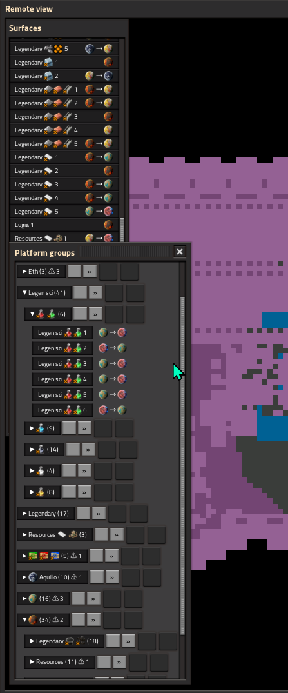

# Fleet Commander

Factorio 2.1 (Space Age) mod. A panel that groups space platforms by common name prefix ("Cargo 1", "Cargo 2" -> Cargo) and acts on a whole group at once.

Open with the top-bar button or `CONTROL + SHIFT + P`.

## Features

- Unlimited-depth grouping by leading name words; icon tags count as one word, numbers are ignored; lone platforms go to "Ungrouped".
- Per platform: name (click to open the platform view), location with travel direction, idle status.
- Idle flags: paused, no schedule, no path, stuck at a station for 10+ minutes; a warning count in each group header.
- Collapsible groups; window positions and fold state persist per player.
- Copy build: snapshots the group's first platform (blueprint with hub, empty foundation spots, hub requests, schedule with interrupts), then applies it to the rest of the group on a second click. Right-click cancels; the snapshot expires after a minute.
- Interrupts: list the group's interrupts and activate one on every platform; cancel active temporary stops.
- Send: pick a location to send the whole group there (adds a temporary 30 s stop).
- Launch: pick a planet to create a new platform named after the group (next number) and configure it from the first platform once its hub is built.

## Status

Experimental. Developed without a way to run Factorio headless, so features were checked in-game by hand; launch, idle flags and cancel stops are not yet confirmed.
